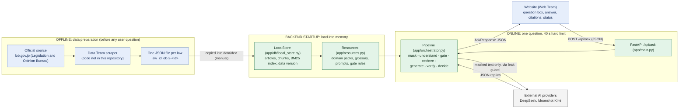
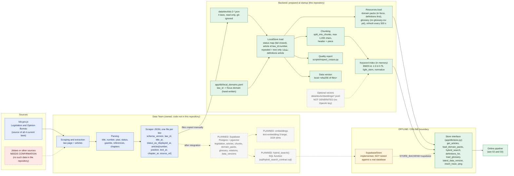
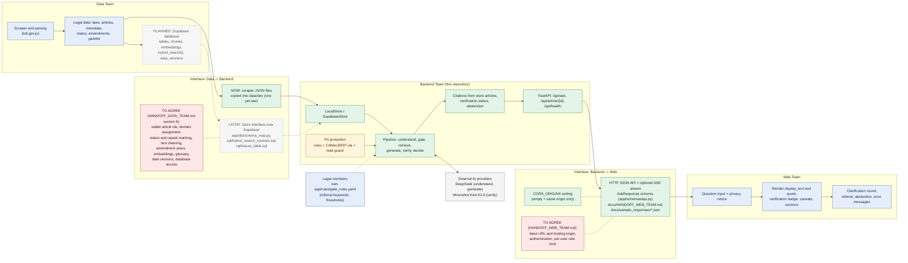

# System Architecture: Jordanian Legal AI Assistant (MVP)

Status date: 2026-11-17. Mapped from the code in this repository. Diagram sources: `docs/diagrams/*.mmd`
(validated with the Mermaid parser; GitHub renders the blocks below).

**Legend (diagram colours):** green = implemented and tested · amber = implemented, not fully validated ·
grey dashed = planned / not active · blue = Data Team or Web Team · red = to agree or needs confirmation ·
orange = early or final non-answer outcome · light grey = external provider.

---

## 1. Overview



The system has three parts:

1. **Offline: data preparation (Data Team).** Laws are scraped from lob.gov.jo into one JSON file per law.
2. **Backend startup: load into memory.** `LocalStore` reads those files, builds article ids, chunks and a BM25
   keyword index. `Resources` builds the domain packs, the glossary, the prompts and the gate rules.
3. **Online: one question at a time.** `POST /api/ask` runs the 7-stage pipeline within a 40-second hard limit and
   returns an `AskResponse` that the Web Team renders.

**Offline/online boundary:** the `Store` interface (`app/db/store.py`). Everything above it prepares data; the
online pipeline only calls its eight operations. Today the implementation is `LocalStore` (files); after
integration it can be `SupabaseStore` (`STORE_BACKEND=supabase`), with no change to the pipeline.

---

## 2. Offline pipeline: data preparation



| Component | Responsibility | Input | Output | Technology | Status | Owner |
|---|---|---|---|---|---|---|
| Source | Official law texts | - | Law and article pages | lob.gov.jo (Legislation and Opinion Bureau) | In use for all 4 laws | Data Team |
| Other sources (e.g. Jolaws) | - | - | - | - | **Needs confirmation**: no such data in this repository | Data Team |
| Scraper and parser | Extract law metadata and articles | Web pages | One JSON per law (`schema_version`, `law_id`, `title_ar`, `status_as_displayed_ar`, `law_number`, `release_year`, `gazette`, `legislation_references`, `articles[]`) | Data Team code (not in this repository) | Exists (files delivered 2026-11-16) | Data Team |
| Data files | Read-only input | Scraper JSON | `data/dev/lob-2-*.json` (git-ignored) | Files | 4 laws | Data Team → Backend (manual copy) |
| Domain mapping | Assign each law to a focus domain | Law ids | `law_id → domain` | `app/db/local_domains.yaml` (hand-written) | Implemented | Backend now; **To agree** for the database |
| LocalStore load | Normalise status (fail closed), build article ids `law_id:number`, detect repealed articles («ملغاة» only) and definitions articles, compute last amendment year | JSON + domains | `Article` objects (`app/schemas/domain.py`) | Python, `app/db/local_store.py` | Implemented and tested | Backend |
| Chunking | Split long articles for search | Article text | Pieces ≤ 1,200 chars, `law_id:number#i`, header + text | `split_into_chunks` | Implemented and tested | Backend |
| Keyword index | Search over chunks | Chunks | BM25 index (k1 1.5, b 0.75), normalised and lightly stemmed tokens | `app/text/arabic.py`, LocalStore | Implemented and tested | Backend |
| Vectors | Semantic search | `data/dev/embeddings/*.jsonl` | Vectors per chunk | `scripts/build_local_embeddings.py`, OpenAI `text-embedding-3-large` (1,024 dims) | **Not active**: no files generated, no key | Backend (local), Data Team (database) |
| Quality report | Detect text defects | Articles | Report | `scripts/inspect_corpus.py`, `LocalStore.quality_report` | Implemented | Backend |
| Data version | Detect data changes | File hashes | `local-<sha12>`, scrape date | `latest_data_version` | Implemented | Backend |
| Resources | Domain packs (in-force articles, definitions first), pack sizes, glossary, prompts, gate rules; refresh every 300 s | Store | In-memory resources | `app/resources.py` | Implemented and tested; glossary empty (no `glossary.csv`) | Backend |
| Database (Supabase + pgvector) | Production storage, embeddings, `hybrid_search()` SQL | Scraper output | Tables in `app/db/schema_map.py` | Postgres, pgvector | **Planned**; contract proposed in `sql/` | Data Team (**To agree**) |
| SupabaseStore | Store implementation over the database | Database | Same `Store` interface | `app/db/store.py`, Supabase REST/RPC | Implemented, **not tested against a real database** | Backend |

**Updates and synchronisation.** Today: copy a new JSON file into `data/dev/`, map its domain, restart; the data
version changes automatically. After integration: load the database, insert a `data_versions` row; the backend
reloads within 5 minutes (`resource_refresh_s = 300`).

---

## 3. Online pipeline: one question

### 3.1 From the browser to the legal context

```mermaid
flowchart LR
  %% B1. Online pipeline, part 1: from the browser to the legal context (continues in 03)
  subgraph WEB["Web Team"]
    UI["Website UI<br/>privacy notice, question box"]
  end

  subgraph API["API layer (app/main.py)"]
    direction TB
    EP["POST /api/ask<br/>JSON or text/event-stream"]
    CORS["CORS (only if CORS_ORIGINS set)"]
    PIIS["PII readiness check<br/>production + name model not loaded<br/>-> HTTP 503"]
    VAL["Request validation (Pydantic AskRequest)<br/>question 2-2000 chars, optional clarification<br/>invalid -> HTTP 422"]
    EP --> CORS --> VAL --> PIIS
  end

  subgraph ORCH["Pipeline.handle (app/orchestrator.py), hard deadline 40 s"]
    direction TB
    REF["Resources.refresh_if_stale"]
    COMP["compose_question<br/>question + clarification reply"]
    MASK["PII masking: PIIMasker.mask<br/>rules: phone, national_id, iban, email (regex),<br/>names (trigger words + common_names.txt)<br/>+ CAMeLBERT-da names if PII_NAME_MODEL=camelbert-da"]
    PH["Masked question with placeholders [شخص_1]<br/>originals kept only in RequestCtx.pii_values"]
    UND["Stage 2: understand (app/stages/understand.py)<br/>prompt understand.md + glossary hints<br/>-> domain, confidence, msa_rewrite, legal_rewrite,<br/>legal_issues, missing_facts, risk_level<br/>failure -> fallback: domain other"]
    GATE["Stage 3: decide_gate (app/stages/gate.py)<br/>rules app/rules/gate_rules.yaml"]
    REF --> COMP --> MASK --> PH --> UND --> GATE
  end

  subgraph STOPS["Early responses"]
    direction TB
    OOS["out_of_scope<br/>not a legal question"]
    REFR["referral<br/>risk high or referral keyword"]
    CLAR["clarification<br/>blocking missing fact, first round only"]
  end

  subgraph RET["Stage 4: Retriever.get_articles (app/stages/retrieve.py)"]
    direction TB
    FOCUS["Domain check<br/>focus domain and confidence >= 0.6?"]
    PACK["Path 'pack': whole law of the domain<br/>in-force articles, definitions first<br/>(if <= 180,000 chars)"]
    PSEARCH["Path 'pack_search': search inside the domain<br/>(law too big; none today)"]
    WORD["Path 'search': 3 wordings<br/>original, msa_rewrite, legal_rewrite"]
    EMBQ["Embed wordings<br/>NOT ACTIVE (no OpenAI key) -> keyword only"]
    HS["Store.hybrid_search per wording (parallel)<br/>LocalStore: BM25 over chunks (+ vectors if present)"]
    RRF["rrf_merge k=60 by article<br/>top 40, in-force only"]
    RR["Rerank (Cohere)<br/>NOT ACTIVE (no key) -> keep RRF order, top 20"]
    EXP["Add definitions articles (max 5)"]
    FOCUS -- yes --> PACK
    FOCUS -- "yes, too big" --> PSEARCH
    FOCUS -- no --> WORD --> EMBQ --> HS --> RRF --> RR --> EXP
    PSEARCH --> WORD
  end

  CTX["Context construction: generate.build_messages<br/>&lt;article id law number year article_no last_amended&gt; blocks<br/>+ masked question + Standard Arabic version + legal issues<br/>-> continues in diagram 03"]
  NOS["no_support<br/>no articles found"]

  subgraph GW["ModelGateway (app/gateway/client.py)"]
    GUARD["Leak guard _guard<br/>blocks the call if any detected personal value<br/>appears in outgoing text (law text excluded)"]
  end

  subgraph EXTP["External providers"]
    direction TB
    DS["DeepSeek API<br/>deepseek-flash, thinking off"]
    OAI["OpenAI embeddings<br/>NOT CONFIGURED"]
    COH["Cohere rerank<br/>NOT CONFIGURED"]
  end

  UI -- "HTTPS JSON" --> EP
  PIIS --> REF
  UND -- "chat_json(understand)" --> GUARD
  EMBQ -. "embed()" .-> GUARD
  RR -. "rerank()" .-> GUARD
  GUARD --> DS
  GUARD -.-> OAI
  GUARD -.-> COH
  GATE -- out_of_scope --> OOS
  GATE -- referral --> REFR
  GATE -- clarify --> CLAR
  GATE -- continue --> FOCUS
  PACK --> CTX
  EXP --> CTX
  RRF -- "nothing found" --> NOS

  classDef done fill:#e3f4e8,stroke:#2e7d4f,color:#14321f
  classDef partial fill:#fff4dc,stroke:#b07d10,color:#4a3405
  classDef planned fill:#f6f6f6,stroke:#999,color:#555,stroke-dasharray:5 4
  classDef partner fill:#e6eefb,stroke:#3a63b0,color:#132a55
  classDef ext fill:#f4f4f4,stroke:#777,color:#222
  classDef stop fill:#fdf0e6,stroke:#c46a1b,color:#4a2508
  class EP,PIIS,VAL,REF,COMP,PH,UND,GATE,FOCUS,PACK,CTX,GUARD done
  class MASK,WORD,HS,RRF,EXP,PSEARCH,CORS partial
  class EMBQ,RR,OAI,COH planned
  class UI partner
  class DS ext
  class OOS,REFR,CLAR,NOS stop
```



### 3.2 From the legal context to the rendered answer

```mermaid
flowchart LR
  %% B2. Online pipeline, part 2: from the legal context to the rendered answer (continues from 02)
  CTX["Context from diagram 02<br/>articles + masked question"]

  subgraph GEN["Stage 5: generate (app/stages/generate.py)"]
    direction TB
    CALL["chat_json('generate')<br/>prompt generate.md, JSON mode,<br/>temperature 0.2, max 3,000 tokens, 20 s"]
    PARSE["extract_json<br/>code fences, split objects merged<br/>(no duplicate keys)"]
    LREP["Local repair: escape_inner_quotes<br/>(content kept exactly, no model call)"]
    MREP["One model repair: REPAIR_PROMPT<br/>with the position where JSON broke"]
    ANS["GeneratedAnswer<br/>status, summary, caveats,<br/>claims: id, text, article_id, quote, essential"]
    CALL --> PARSE
    PARSE -- valid --> ANS
    PARSE -- invalid --> LREP
    LREP -- valid --> ANS
    LREP -- invalid --> MREP
    MREP -- valid --> ANS
  end

  subgraph VER["Stage 6: verify (app/stages/verify.py)"]
    direction TB
    CODE["code_checks per claim<br/>article supplied, exact quote,<br/>numbers in article, in force"]
    ALC["answer_level_checks<br/>numbers in summary and caveats<br/>must come from question or cited articles"]
    SEM["Semantic check: chat_json('verify')<br/>each cited article once + claims + summary<br/>one verdict per claim id and for 'summary'<br/>prompt verify.md, 18 s"]
    REP["VerificationReport<br/>failures, summary_verdict, semantic_skipped"]
    CODE --> SEM
    ALC --> REP
    SEM -- "verdicts" --> REP
    SEM -- "timeout or error -> semantic_skipped" --> REP
  end

  subgraph DEC["Stage 7: decide (app/stages/decide.py)"]
    direction TB
    ALL["Check: all claims and checks passed?"]
    RW["Check: rewrite allowed?<br/>attempt 1 and time left >= max(15 s,<br/>1.25 x (generate + verify) + 1.5 s)"]
    ESS["Check: abstain?<br/>essential claim failed or<br/>more than 50% of claims failed"]
    DROP["Drop failed non-essential claims<br/>answer marked partial"]
    SUM["Summary shown only if verdict 'supported',<br/>else neutral sentence"]
    ALL -- no --> RW
    RW -- no --> ESS
    ESS -- no --> DROP --> SUM
    ALL -- yes --> SUM
  end

  subgraph OUT["Response (app/orchestrator.py)"]
    direction TB
    CIT["_answer_out: ClaimOut per claim<br/>citation.label from the LocalStore article<br/>display_text = text + (label)"]
    STAT["verification = verified or<br/>not_semantically_verified (checker did not run)"]
    REST["_restore: placeholders back to the user's values"]
    RESP["AskResponse JSON<br/>type answer, clarification, referral,<br/>no_support, out_of_scope, error"]
    TR["insert_trace (background)<br/>logs/traces.jsonl, no question text"]
    CIT --> STAT --> REST --> RESP
    RESP --> TR
  end

  subgraph ENDS["Other final outcomes"]
    direction TB
    UNV["no_support (abstain)<br/>message UNVERIFIED"]
    REFL["referral<br/>generator status needs_lawyer"]
    ERR["error<br/>invalid JSON after repair, time-out,<br/>leak guard block, retrieval failure"]
  end

  subgraph GW["ModelGateway"]
    GUARD["Leak guard _guard<br/>before every external call"]
  end
  DS["DeepSeek API<br/>deepseek-flash"]
  KIMI["Moonshot API<br/>kimi-k2.6, thinking off"]
  UI["Website (Web Team)<br/>display_text + quote, verification badge,<br/>caveats, clarification input, messages,<br/>privacy notice"]

  CTX --> CALL
  CALL --> GUARD
  MREP --> GUARD
  SEM --> GUARD
  GUARD -- generate --> DS
  GUARD -- verify --> KIMI
  MREP -- invalid --> ERR
  ANS --> CODE
  ANS --> ALC
  REP --> ALL
  RW -- "yes: rewrite with feedback" --> CALL
  ESS -- yes --> UNV
  SUM --> CIT
  SUM -. "status needs_lawyer" .-> REFL
  RESP -- "HTTP 200 JSON or SSE 'result'" --> UI
  UNV --> RESP
  REFL --> RESP
  ERR --> RESP

  classDef done fill:#e3f4e8,stroke:#2e7d4f,color:#14321f
  classDef partial fill:#fff4dc,stroke:#b07d10,color:#4a3405
  classDef partner fill:#e6eefb,stroke:#3a63b0,color:#132a55
  classDef ext fill:#f4f4f4,stroke:#777,color:#222
  classDef stop fill:#fdf0e6,stroke:#c46a1b,color:#4a2508
  class CTX,CALL,PARSE,LREP,MREP,ANS,CODE,ALC,SEM,REP,ALL,RW,ESS,DROP,SUM,CIT,STAT,REST,RESP,TR,GUARD done
  class UI partner
  class DS,KIMI ext
  class UNV,REFL,ERR stop
```



### 3.3 Components

| # | Component | Responsibility | Input | Output | Technology / model | Status | Owner |
|---|---|---|---|---|---|---|---|
| 1 | Website UI | Question box, privacy notice, rendering | User input | `POST /api/ask` | Web Team stack (**Needs confirmation**) | Not in this repository | Web Team |
| 2 | CORS | Allow a website on another origin | Browser request | CORS headers | FastAPI `CORSMiddleware`, `CORS_ORIGINS` | Implemented and tested; origin **To agree** | Backend |
| 3 | `/api/ask` | Entry point; JSON or `text/event-stream` | `AskRequest` | `AskResponse` / SSE `stage` + `result` events | FastAPI `app/main.py` | JSON implemented and tested; SSE implemented, not tested | Backend |
| 4 | Request validation | Reject bad input | Body | HTTP 422 or a valid request | Pydantic (`question` 2-2,000 chars; `clarification` optional) | Implemented and tested | Backend |
| 5 | PII readiness | Refuse service if PII protection is not ready in production | `PIIStatus` | HTTP 503 | `app/pii/factory.py` | Implemented and tested | Backend |
| 6 | PII masking | Replace personal data with placeholders | Question (+ clarification) | Masked text, mapping, `pii_values` | `PIIMasker`: regex (phone, national_id, iban, email) + name triggers + `common_names.txt`; CAMeLBERT-da (`CAMeL-Lab/bert-base-arabic-camelbert-da-ner`, CPU, sentence chunks of ≤ 128 pieces) when `PII_NAME_MODEL=camelbert-da` | Rules: implemented and tested. CAMeLBERT: implemented, not fully validated; code default `none`; deployment setting **Needs confirmation** | Backend |
| 7 | Leak guard | Block any external call whose user text contains a detected personal value (law text excluded) | Outgoing texts | Call allowed or `PIILeakError` → `error` | `ModelGateway._guard`, before `chat_json`, `embed`, `rerank` | Implemented and tested | Backend |
| 8 | Understand | Intent, domain, confidence, rewrites, issues, missing facts, risk | Masked question + glossary hints | `Understanding` | DeepSeek `deepseek-flash`, thinking off, 6 s, `app/prompts/understand.md`; on failure a fallback with domain `other` | Implemented and tested; validated on 4 real questions | Backend |
| 9 | Decision gate | First match wins: not legal → out of scope; risk high or keyword → referral; blocking missing fact (first round) → clarification; else continue. Focus label below confidence 0.6 → `other` | `Understanding`, masked question | `GateDecision` | `app/stages/gate.py`, `app/rules/gate_rules.yaml` | Implemented and tested | Backend; rules owned by the legal members |
| 10a | Retrieval: pack | Whole law of the focus domain (in-force articles, definitions first) if ≤ 180,000 chars | Domain | Articles, path `pack` | `Resources.packs` | Implemented, tested, validated | Backend |
| 10b | Retrieval: pack_search | Search inside the domain when the law is too big (none today) | Wordings + domain | Up to 40 articles | Same as 10c | Implemented and tested; not triggered by current data | Backend |
| 10c | Retrieval: search | Three wordings (original, `msa_rewrite`, `legal_rewrite`) → `hybrid_search` each in parallel → `rrf_merge` (k=60, 40 candidates, in force) → rerank (top 20) → definitions (≤ 5) | Masked question, `Understanding` | Articles, path `search` | `LocalStore.hybrid_search` (BM25; vectors only if present); embed: OpenAI, rerank: Cohere `rerank-v3.5` | BM25 + RRF implemented and tested; **embed and rerank not active** (no keys); not validated end to end; corpus = the same 4 laws | Backend |
| 11 | Context construction | Build the writing prompt | Articles, question, rewrite, issues | Messages: `<article id law type number year article_no last_amended>` blocks first | `generate.build_messages` | Implemented and tested | Backend |
| 12 | Generate | Write the answer as JSON claims with exact quotes, essential flags, summary, caveats | Context | `GeneratedAnswer` | DeepSeek `deepseek-flash`, thinking off, temperature 0.2, 3,000 tokens, 20 s, JSON mode, `app/prompts/generate.md` | Implemented and tested; validated on 4 real questions | Backend |
| 13 | JSON parsing and repair | Parse; merge split objects (no duplicate keys); local quote escaping; one model repair told where it broke; otherwise `ModelOutputError` → `error` | Raw reply | Valid JSON or error | `extract_json`, `_merge_split_objects`, `escape_inner_quotes`, `REPAIR_PROMPT` | Implemented and tested | Backend |
| 14 | Code checks | Per claim: article supplied, exact quote (≥ minimum length), numbers present in the article, in force. Answer level: numbers in summary/caveats come from the question or cited articles | `GeneratedAnswer`, articles | `ClaimCheck`s, answer failures | `app/stages/verify.py`, `app/verify_checks/{quotes,numbers}.py` | Implemented and tested | Backend |
| 15 | Semantic check | One verdict per claim against its own article, and one for the summary; each cited article sent once | Claims passing code checks, articles, masked question, summary | `VerifierOutput` | Moonshot `kimi-k2.6`, thinking off, 18 s, `app/prompts/verify.md` | Implemented and tested; validated on 4 real questions | Backend |
| 16 | Decide | Deliver, rewrite once (only if time left ≥ max(15 s, 1.25 × (generate + verify) + 1.5 s)), drop failed non-essential claims (partial), abstain if an essential claim failed or > 50 % failed, neutral summary unless `supported`, mark `not_semantically_verified` if the checker did not run, referral for `needs_lawyer` | `VerificationReport` | `Decision` | `app/stages/decide.py` | Implemented and tested | Backend |
| 17 | Citations | Build `ClaimOut` from the stored article: `citation.label` = «law title، المادة n», `display_text` = text + label; claims without a stored article are never output | Kept claims, articles | `AnswerOut` | `_answer_out` | Implemented and tested | Backend |
| 18 | Restore and respond | Put the user's values back into the shown text; build `AskResponse`; write a trace in the background | Decision, mask mapping | `AskResponse` | `_restore`, `insert_trace` (`logs/traces.jsonl`; no question text except test requests with `X-Eval-Token`) | Implemented and tested | Backend |
| 19 | Rendering | Show `display_text`, quote, verification badge, caveats, clarification input, messages, privacy notice | `AskResponse` | Screen | Web Team | **Web Team** | Web Team |

**Time budget.** `Deadline(40 s)` is enforced by `asyncio.wait_for` around the whole pipeline and by the gateway,
which caps each call at `min(role timeout, time left − 1.5 s)` and refuses calls with less than 2 s left. Typical
measured times: understand ~2 s, generate 6-16 s, verify 8-15 s, total 17-33 s.

**Disabled by default:** the response cache (`DEMO_CACHE=false`).

---

## 4. Team integration



| Interface | Between | What crosses it | Defined in | Status |
|---|---|---|---|---|
| Scraper JSON files | Data Team → Backend | One file per law in `data/dev/` | `docs/HANDOFF_DATA_TEAM.md` §2, §4 | In use |
| `Store` over the database | Data Team → Backend | Tables, `hybrid_search()`, `data_versions`, `traces` | `app/db/schema_map.py`, `sql/hybrid_search_contract.sql`, `sql/traces_table.sql` | Planned; **To agree** (§6: article ids, domains, status, text cleaning, amendments, embeddings, glossary, versions, access) |
| HTTP API | Backend → Web Team | `AskRequest` / `AskResponse`, `/api/article/{id}`, `/api/health`, SSE | `app/schemas/api.py`, `docs/HANDOFF_WEB_TEAM.md`, `docs/sample_responses/` | Implemented and tested; base URL, hosting origin, authentication, rate limiting **To agree** |
| Gate rules | Legal members → Backend | Referral keywords, risk levels, confidence threshold | `app/rules/gate_rules.yaml` | Implemented; list to be reviewed |
| Model providers | Backend → DeepSeek, Moonshot | Masked text only (after the leak guard) | `app/gateway/models.yaml` | In use; keys in environment variables / Replit Secrets |

---

## 5. API request and response flow (actual schemas, `app/schemas/api.py`)

```text
POST /api/ask
  AskRequest { question: str (2..2000), clarification?: { original_question, clarifying_question, answer } }

200 AskResponse {
  request_id: str
  type: "answer" | "clarification" | "referral" | "no_support" | "out_of_scope" | "error"
  domain: str | null              coverage: "focus" | "initial" | null
  answer: AnswerOut | null        clarifying_question: str | null
  referral: { reason } | null     message: str | null
  data_version: { version, scraped_at }      timings_ms: { stage: ms, ... }
}
AnswerOut {
  summary: str
  sections: { rights: [ClaimOut], obligations: [ClaimOut], steps: [ClaimOut], conditions: [ClaimOut] }
  caveats: [str]   partial: bool   amendment_warning: bool
  verification: "verified" | "not_semantically_verified"
}
ClaimOut { text, display_text, citation: { article_id, quote, label } }

422  invalid body (FastAPI)          503  { detail, pii_name_model }  PII protection not ready (production)
GET /api/article/{id} -> ArticleOut { id, law_title, type, number, year, article_no, text, status,
                                      last_amendment, gazette, source_url }   (404 if unknown)
GET /api/health -> HealthOut { status: ok|degraded|unavailable, database, models, data_version, pii_name_model }
Accept: text/event-stream -> events "stage" {stage: understanding|searching|writing|checking}, then "result"
```

Examples of every state: `docs/sample_responses/*.json` (validated by `tests/test_pipeline.py`).

---

## 6. Configuration in use

| Setting | Value | Where |
|---|---|---|
| understand / generate | DeepSeek `deepseek-flash`, thinking off; 6 s / 20 s | `app/gateway/models.yaml` |
| verify | Moonshot `kimi-k2.6`, thinking off, temperature not sent; 18 s | `app/gateway/models.yaml` |
| embed / rerank | OpenAI `text-embedding-3-large` (1,024) / Cohere `rerank-v3.5` | `models.yaml`; **no keys: not active** |
| Budget, reserve, minimum call | 40 s, 1.5 s, 2 s | `app/config.py` |
| Pack limit, chunk size | 180,000 chars, 1,200 chars | `app/config.py` |
| Store | `STORE_BACKEND=local` | `app/config.py` |
| PII name model | code default `none`; `camelbert-da` used in the latest validation runs | `PII_NAME_MODEL`; deployment value **Needs confirmation** |
| Environment | `APP_ENV=development` default; `production` turns PII failures into 503 | `app/config.py` |
| CORS | empty (same origin only) | `CORS_ORIGINS` |

---

## 7. Cross-check: diagram blocks against the code

Every block was checked against these locations on 2026-11-17.

| Block | Code |
|---|---|
| lob.gov.jo source | `official_source_url` in all 4 files in `data/dev/` |
| LocalStore load, status map, ids, repealed, definitions | `app/db/local_store.py` (`STATUS_MAP`, `_REPEALED_ONLY`, `DEFINITIONS_MARKERS`) |
| Chunking, BM25 | `split_into_chunks`, `_bm25_ranking` in `app/db/local_store.py` |
| Optional vectors | `LocalStore._load_vectors`, `scripts/build_local_embeddings.py` (no `data/dev/embeddings/`) |
| Domain mapping | `app/db/local_domains.yaml` |
| Resources, packs, refresh | `Resources.load`, `refresh_if_stale` in `app/resources.py` |
| Store interface, SupabaseStore | `app/db/store.py`, `app/db/schema_map.py` |
| Endpoints, CORS, 503, SSE, static web | `app/main.py` (`/api/ask`, `/api/article/{article_id}`, `/api/health`, `configure_cors`, `./web` mount if present) |
| Masking, CAMeLBERT | `app/pii/masker.py`, `app/pii/name_model.py`, `app/pii/factory.py` |
| Leak guard | `ModelGateway._guard`, called in `chat_json`, `embed`, `rerank` |
| Understand, gate | `app/stages/understand.py`, `app/stages/gate.py`, `app/rules/gate_rules.yaml` |
| Retrieval paths | `Retriever.get_articles`, `search`, `rrf_merge`, `_rerank`, `_expand` in `app/stages/retrieve.py` |
| Generate, JSON repair | `app/stages/generate.py`; `extract_json`, `_merge_split_objects`, `escape_inner_quotes` in `app/gateway/client.py` |
| Verify, decide | `app/stages/verify.py`, `app/stages/decide.py` |
| Citations, restore, trace | `_answer_out`, `_restore` in `app/orchestrator.py`; `insert_trace` |

---

## 8. Needs confirmation / to agree

1. **Other data sources (e.g. Jolaws):** none in this repository; only lob.gov.jo is confirmed.
2. **Data Team scraper code and process:** not in this repository (delivered files only).
3. **PII name model in deployment:** `camelbert-da` (as validated) or `none`; depends on server memory (+720 MB).
4. **Web Team stack and hosting origin:** not in this repository; decides `CORS_ORIGINS` or serving from `./web`.
5. **Deployment platform:** Replit planned; not set up; startup time and memory not measured.
6. **Database schema and article ids:** `HANDOFF_DATA_TEAM.md` §6.
7. **Authentication and rate limiting:** not implemented; required before public exposure.
8. **Streaming endpoint:** implemented but not covered by tests.
